# S0 architecture · KTRU card service

S0 means **open fact extraction + catalog search + deterministic checking**. The core pipeline below is implemented.
Product acceptance requires separate evaluation on representative catalog data.

The executable contract is `backend/src/ktru/contracts.py` (`s0-4`) plus the typed routes in
`backend/src/api/ktru/app.py`.
`backend/scripts/export_contract.py` generates `frontend/src/api/ktru.generated.ts` from Pydantic JSON Schema.
`--check` detects drift; `frontend/src/api/ktru.ts` contains the HTTP client. Do not maintain another API schema.

## Product and invariants

A supplier enters a Russian description of clothing, furniture or tools. The service preserves stated facts,
finds possible KTRU positions, explains exclusions, asks questions and returns an editable card.
Each field has a KTRU / Portal / New source badge. Subject is optional; catalog-only fields and unparsed
fragments may lack a subject, and unparsed fragments may lack structured evidence. A final code and a complete card
are separate results.

- Extraction is independent of candidate schemas and runs before retrieval. JSON constrains structure, not the
  property vocabulary. The service consumes typed extraction and retrieval results on every transition.
- The model proposes interpretations. Code checks grounding, parses quantities, converts units, validates values and
  resolves compatible / contradicts / unknown. An ambiguous subject or negation scope cannot exclude a position.
- Keep item, part, package and set facts separate. A valid quote alone does not prove the right object relation.
- A description of several products («Стул 4шт и молаток 2шт», a pasted table, «два стула: один синий, второй
  зеленый», «Брюки 48 и куртка 50 упакованы в один костюм») gets one subject per product (`engine.products`):
  items, numbered instances under a batch, sets with member parts. Counts and statements move to the product that
  owns them. The first item stays the root: only its facts bind to the catalog family and Portal fields.
- No extractor wins by default. Merge equivalent normalized facts with their sources. Preserve conflicting facts.
- Unbound properties remain Portal/New. Invalid catalog values retain source data and a diagnostic. The same
  catalog validation guards comparisons, questions and automatic fills. A defective required field cannot be ready.
  Invalid model
  grounding is rejected with a reason. No silent removal of difficult facts.
- Catalog-derived fixed values do not count as evidence from the input or as proof for choosing that code.
- The card exposes up to five family summaries; the UI renders the supplied families and live candidates.
  The top-3 recall metric is an evaluation target, not a UI limit or proof of search coverage.
  Expand all ACTIVE final members of each proposed family.
  A single survivor is final only in a confirmed, exhaustive scope; otherwise it is a suggestion.
  A family is confirmed by the user's answer, or without a question when the text names exactly one family
  completely (every word of its name, no equally specific rival, search not position-limited).
- An extra property must exist somewhere in the product domain (KTRU positions or the Portal schema of that
  domain). Otherwise the value is kept and the card warns that it does not belong («тяга двигателя» у стола).
- A picked catalog option matches exactly; a label written in the text may be general («Металл» covers
  «Металл хромированный») and is then asked about if it still splits the candidates.
- Open models only in the product; total Linux inference VRAM at most 40 GB. Swarm worker models build code and are
  not product inference providers.

## Components

```mermaid
flowchart LR
  XML[Actual KTRU XML] --> Build[catalog.build]
  Excel[Portal Excel] --> Build
  Build --> Snap[(Immutable SQLite + FTS5 snapshot)]
  Text[Original text + revision] --> Rules[service.stages.Rules]
  Text --> Extract[service.stages.OpenModel + ml grounding]
  Rules --> Facts[ExtractionResult: merged open assertions]
  Extract --> Facts
  Text --> Retrieve[service.stages.HybridRetriever: lexical fast path + RRF]
  Snap --> Retrieve
  Snap --> VectorBuild[Offline catalog.vector builder]
  VectorBuild --> Vectors[(Hashed family vectors + pinned E5 INT8)]
  Vectors --> Retrieve
  Retrieve -->|configured| Rank[Optional local family classifier: rank only]
  Rank --> Scope
  Retrieve -->|default| Scope[RetrievalResult: complete families + search scope]
  Facts --> Bind[engine.binding: subjects + schema proposals]
  Scope --> Bind
  Bind --> Check[engine.compatibility: typed checks + ResolutionResult]
  Check --> Fields[engine.fields: KTRU / Portal / New]
  Fields --> Questions[engine.questions + engine.readiness: domain relevance of extras]
  Questions --> Card[engine.resolve: card assembly]
  Card --> API[service.pipeline + FastAPI: CAS + idempotency]
  API --> UI[React card]
  UI -->|answer / edit / undo| API
  Validation[catalog.validation: usable characteristics and values] --> Check
  Validation --> Fields
  Validation --> Questions
```

Source proposals now share `assertions.local_relation` and `assertions.contextualize`: local owner, factuality,
history, preference, alternatives and quoted labels. The independent categorical rule pass extracts material
and color values before family selection. The model grounding validator remains stricter about quoted values,
units and supplied subjects. Part and package facts do not supersede the item's facts.

The implemented schema-aware rule pass in `engine.binding` adds proposals after family selection. It does not
replace open assertions or remove extras. An additional model pass remains an optional measured extension.

| Owner | Path | Responsibility |
|---|---|---|
| api | `backend/src/ktru/contracts.py` | Data models and errors; no domain logic |
| data | `backend/src/ktru/catalog/` | XML/Excel, versions, supply units, families, snapshot, lexical search and shared validation |
| engine | `backend/src/ktru/engine/` | Values, rule proposals, binding, compatibility, fields, questions, diagnostics, readiness, canonical fact vocabulary (`canonical.py`: presence, materials, colours, property names, product label, modality), spelled numbers (`numwords.py`), source maps and card assembly |
| ml | `backend/src/ktru/ml/` | Open-model transport, extraction, grounding validator and optional local family classification |
| api | `backend/src/ktru/service/` | Injected extraction/retrieval adapters, pipeline, sessions, CAS, idempotency, undo and timings |
| api | `backend/src/api/ktru/app.py` | Typed HTTP, OpenAPI, lifespan (standalone app, no database) |
| ui | `frontend/src/` | Portal-style card, evidence, questions, edits and export |
| qa | `eval/`, `backend/tests/eval/`, `frontend/e2e/` | Independent gold, metrics and browser checks |

Imports: HTTP → service → engine / ml / catalog → contracts. Engine and catalog never call models.
Use `src.ktru` imports. Fake output, if any, is marked and cannot satisfy product acceptance.

## Requests and state

`/parse` accepts a text edit atomically and returns provisional rules/lexical results without waiting for a model.
`/analyze` works on the accepted revision. Run extraction and search, then resolve. Publish only if the base revision
still matches current state. `/answer`, `/edit`, `/undo` use atomic compare-and-swap and increment server revision.
Retry of a retained request ID with the same payload returns its original result; another payload is an error.
Replay retention is bounded by 20 requests and 128 KiB of serialized results per session. After eviction,
revision checks apply. An oversized current card remains available without a replay entry.
Stale requests return 409. The UI preserves its draft and refreshes state. Browser cancellation alone is not sufficient.
Questions and fixes carry a revision and snapshot. Field edits use the current card's IDs and the request revision.
Some field IDs remain stable across recomputation so the UI can retain drafts.

`replace_span` fixes address one exact original-text interval. The API checks the source quote, code-point offsets,
snapshot and revision before changing it. The UI uses code points too. The legacy whole `replace_text` edit remains
supported. `normalized_text` contains layout correction; `search_text` also includes search-only spelling changes.
`correction_map` stores every changed interval from the original text to search text. Unchanged gaps are implicit
and validated. Repeated words keep separate intervals; display corrections group repeated spellings.

`funnel_scopes` declares each counter's universe: the snapshot, retrieved families, or the selected full family.
Funnel stages link a scope and the facts, answers or catalog sources used at that step. A retrieval count is not a
logical exclusion. Diagnostics publish the affected subject, characteristic references and all relevant evidence.
`contract_validation` rejects false source quotes, revisions, dangling IDs and inconsistent snapshot/position refs
before a card is published. An implicit item parent for a stated part carries no invented source quote.

The UI accepts `/parse` first, then calls `/analyze` for that revision if a model is configured.
Late replies cannot replace a newer card. Field and numeric drafts survive background analysis and conflict recovery.
When their subject/property/unit changes, retain a separate draft rather than apply it to a different field.
Independent observations with the same property retain separate drafts. `analysis_busy` is retryable; the server
admits `KTRU_LLM_CONCURRENCY` model calls (default 4) and one per session revision. Model output is capped at 1 MiB, 128 facts and 4096 tokens.

Open assertions are extracted before retrieval and survive an unknown family. Equal normalized values merge their
evidence. Conflicts suspend that constraint. Grounding checks the original span, local property/value relation,
number, unit, bound and subject. A missing source unit cannot inherit a catalog unit to exclude a position.
User field answers may explicitly use that field's unit. Mixed-unit ranges normalize both bounds first.

Search reports SQL/family truncation. Family confirmation establishes conditional scope only when all active final
members were loaded. An unconfirmed singleton remains a suggestion. Numeric question counts use actual compatibility,
including overlap; an interval option may preserve multiple candidates.

FTS matching now groups active final positions by family before the search limit. At most 64 distinct lexical
families are ranked; eight are retained, with truncation reported. Their complete active final members are loaded.
A large family cannot consume the former 400-position row limit and hide another matching family.

Every transition re-extracts rules and searches the accepted text, then checks the full candidate universe,
including earlier exclusions. Replacing text clears answers and edits; cached model facts apply only to the same
text and are re-scoped to the new revision. Undo creates a new revision and recomputes.
Sessions use an in-memory store in **one API process** for the demo. Multiple workers require a shared transactional
store. Restart or eviction returns session_expired. Each session pins one snapshot.
`SessionStore` owns atomic creation, request replay and revision CAS. A failed transition changes no stored inputs.
Published states and returned cards are separate deep copies. Oversized cards remain available, but do not enter
the bounded replay cache.

## Data and artifact boundaries

Current actual-only XML: **82 files, 81,465 records, 60,087 ACTIVE, 5,897 ACTIVE templates, 54,190 ACTIVE non-templates**.
The older 181,492 records / 81,468 codes include historical XML. They are a different input scope.
Validate current sources against the audit/launch manifest; changed inputs need new hashes and counters.

Each worker writes to its own `$KTRU_BUILD_DIR`, normally `<worktree>/.ktru-build/`. Gate runs have a separate local
build directory. A's local binary is not automatically available to C/D/F. They reuse A's committed builder with the
same read-only sources. Optional `KTRU_SHARED_BUILD_DIR` is a read-only reference; verify manifest/hash before use.
No worker publishes a shared mutable snapshot.

Snapshots contain `catalog.sqlite` and `manifest.json`: source hashes, parser/schema version, date, counts and
quarantine reasons. Build in a private staging directory, then publish atomically in the local build directory.
Never mutate a published snapshot. Index identity includes snapshot, model revision and preprocessing hash.
No raw data, weights, indexes or catalog binaries enter git.

Preserve the position's OKEI supply-unit list separately from characteristic units. Preserve kinds 1, 2 and 3 and
unknown raw kinds; do not infer their semantics. Reader results retain XML element/characteristic/value source
indices, parent version, dates, rubricators, value types, defects and snapshot-scoped value references.
Missing or duplicate characteristic codes do not create false references. Defective schemas remain unknown for
comparison and cannot supply question options or fixed values. Portal matching checks object, type, unit and value domain.

## Search and models

Start with SQLite FTS5/BM25, aliases and a measured typo-tolerant lexical channel if needed. Test full-catalog search,
not only known demo families. Low score means uncertain retrieval: broaden search or ask; it does not prove out of scope.

| Role | Baseline / candidate | Required evidence |
|---|---|---|
| Extraction baseline | Gemma 4 E4B via Ollama, as in the diagnostic pilot | Pin digest/config; rerun full-contract dev tests |
| Extraction candidate | Qwen3-4B-Instruct-2507 quantized, or another verified open model | Exact revision/license/runtime, quality and Linux resources |
| Implemented dense | multilingual E5-small, pinned INT8 ONNX, CPU via FastEmbed | Full-catalog family index; paired development recall and latency, not Linux acceptance |
| Optional rerank | Qwen3-Reranker-0.6B or measured alternative | Gain over lexical/hybrid without candidate loss |
| Optional family classifier | Local GLiNER2.5-multi-Decide, CPU float32 | File hashes, full-pipeline gain, calibrated abstention and Linux resources |

These are candidates, not measured winners. The pilot used 24 constructed descriptions and does not prove Linux
resources, full-product accuracy or Qwen performance. The implemented adapter uses the OpenAI-compatible HTTP API, including Ollama. Tests inject an extractor without network calls. Verify model identity, license/revision and endpoint configuration. API format alone
does not establish openness. No proprietary fallback. Reports omit credentials.

`catalog.vector` builds exact cosine vectors for every family with ACTIVE non-template members. Its identity pins
the SQLite hash, model revision/file hashes and preprocessing. API startup verifies that identity and loads only
local files. `HybridRetriever` skips embedding inference when the product head matches exactly; otherwise it
uses reciprocal-rank fusion of the lexical and dense pools. Dense scores never become textual evidence or confirm
the family. `Pipeline` selects this adapter when a matching local index exists, with a diagnosed lexical fallback
for invalid indexes or inference failures. Complete member schemas are loaded only after ranking. A bounded
snapshot-bound result cache covers parse/answer/edit/undo; spelling corrections and family-name stems are reused.

`ml.classify` loads existing local files only. Install `uv sync --extra classifier --locked --python 3.12` and set
`KTRU_CLASSIFIER_PATH` to those files to enable it. It uses unique head-compatible family names plus `UNKNOWN`.
Duplicate names, low scores or `UNKNOWN` preserve lexical order. Invalid inference preserves all families and
publishes a diagnostic. It never removes a family or confirms coverage. The 0.5 threshold is uncalibrated.
The adapter records file hashes and inference settings; its bounded cache uses the source text and label pool.
It is off by default: the team's paired 60-case validation found no gain over the improved rules.

## Targets and acceptance

Team targets: warm p95 parse/answer/edit/undo ≤150 ms; analyze ≤2.5 s; startup <20 s. These are targets, not passed gates.
`eval/thresholds.yaml` stays unchanged; its 24 GB target is stricter than the organizer's 40 GB cap.
Measure cold/warm latency, sample count, concurrency, failures and total inference VRAM on the selected Linux machine.
Compose runs backend, frontend and optional open-model server; snapshot mounts are read-only at runtime.

The 17 seed cases are smoke tests. Dev and acceptance metrics are separate. Missing required metrics/cases fail.
QA writes frozen cases inside its own build directory. The controller supplies `KTRU_HOLDOUT_DIR` to the gate.
A directory name does not enforce secrecy: record access and previous runs. If the set guides fixes, it is validation;
a fresh sealed set is needed for an independent acceptance claim. All final diagrams and numbers must match the real run.

The implemented boundaries publish `CatalogReader`, `RuleExtractor`, `FactExtractor`, `Retriever`, `Resolver`,
`CardAssembler`, `QuestionSelector`, `Diagnostics`, `Readiness`, `SessionStore` and `Pipeline` Protocols.
`Pipeline` injects their real default adapters. Candidate resolution returns the runtime `ResolutionData` envelope;
its `result` is the published `ResolutionResult` with candidates, bindings, compatibility and conflicts.
`CardAssembler` assembles the card separately. Recording tests prove the injected candidate, question, diagnostic
and readiness output reaches cards in both family paths; retained request replay runs no stages.
`ExtractionResult`, `RetrievalResult`, `ResolutionResult`, `QuestionResult`, `DiagnosticsResult` and `ReadinessResult`
carry actual output. `RetrievalResult` is an in-process dataclass with complete catalog members, not an HTTP schema.
`CardState.model_manifests` records available model revision, runtime, prompt hash and generation parameters.
An observed model digest does not by itself establish a Linux resource or quality result.

The remaining architecture-contract block above is implemented. Full target-shape equivalence to every draft
SCHEMA field remains a separate claim; runtime signatures and legacy shapes are stated in SCHEMA.
A shared transactional session store is required before multiple API workers. Independent gold, Linux total
inference VRAM and latency gates are still required. Dense retrieval is implemented; reranking remains an
optional measured extension. The search benchmark uses existing development data and does not establish acceptance.
