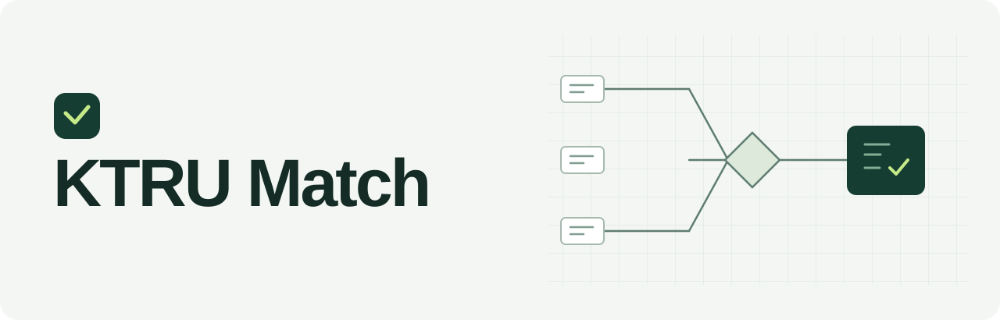

# KTRU Match



[](https://github.com/rTexty/ktru-match/actions/workflows/ci.yml)


KTRU Match помогает специалистам по закупкам подобрать позицию КТРУ по свободному описанию товара. Сервис извлекает характеристики, сверяет их со справочником и задаёт уточняющий вопрос, если для выбора позиции не хватает данных.

- Карточка показывает код, версию и статус позиции, обязательные характеристики и расхождения с описанием.
- Для серии товаров можно загрузить CSV со столбцом «наименование товара», открыть карточку каждой строки и выгрузить результаты.
- Основной сценарий работает на правилах и SQLite FTS5. Для дополнительного извлечения характеристик можно подключить локальную модель.

## Попробовать

**[Открыть демо в браузере](https://rtexty.github.io/ktru-match/)**

Выберите «Молоток», нажмите «Подобрать позицию» и укажите массу. Можно отменить ответ, посмотреть ход подбора и скачать карточку. Демо воспроизводит ответы движка на готовых примерах из учебного каталога. Для ввода своего описания запустите приложение локально.

### Локальный запуск

Понадобится Docker с Compose.

```bash
docker compose up --build -d --wait
```

Откройте [localhost:8080](http://localhost:8080) и введите «Молоток, масса 500 г». Демо использует синтетический каталог с двумя вариантами молотка. Код `DEMO-HAMMER-500` подходит только для знакомства с интерфейсом. Чтобы увидеть уточнение, введите «Молоток» без массы.

```bash
docker compose down
```

## Запуск со своим каталогом

Поместите архив КТРУ в `data/ktru.zip`, а таблицы Портала поставщиков в `data/portal/`. Сборщик ожидает архив с вложенными ZIP и читает из них актуальные файлы `*_actual_*.xml`. Для запуска без таблиц оставьте каталог `data/portal/` пустым.

```bash
mkdir -p data/portal
docker compose -f compose.yaml -f compose.catalog.yaml up --build -d --wait
```

Для других путей задайте `KTRU_ARCHIVE` и `KTRU_PORTAL_DIR`. Отдельное имя Compose хранит рабочий каталог в отдельном томе. После замены входных файлов пересоздайте тома этого проекта через `docker compose -f compose.yaml -f compose.catalog.yaml down -v`, затем повторите запуск. Входные файлы монтируются только для чтения. Для одновременного запуска демо и своего каталога задайте второй системе другой порт через `KTRU_PORT`.

Для гибридного поиска подготовьте векторный индекс и перезапустите API.

```bash
docker compose -f compose.yaml -f compose.catalog.yaml --profile hybrid run --rm vector-index
KTRU_SEARCH_MODE=hybrid docker compose -f compose.yaml -f compose.catalog.yaml up -d api
```

При подключении локальной модели задайте `KTRU_LLM_URL` и `KTRU_LLM_MODEL`. Профиль `llm` в Compose добавляет Ollama. После установки модели в Ollama адрес для контейнера API будет `http://llm:11434`.

## Разработка

Понадобятся Python 3.12 с uv, Node.js 22 и pnpm 10.22.0.

```bash
cd backend
uv sync --frozen --python 3.12
uv run --frozen python -m src.ktru.catalog.build ../demo ../.ktru-build/demo-snapshots
KTRU_SEARCH_MODE=lexical KTRU_SNAPSHOT_DIR=../.ktru-build/demo-snapshots/current \
  uv run --frozen uvicorn src.api.ktru.app:app --host 127.0.0.1 --port 8010
```

В другом терминале из корня репозитория:

```bash
cd frontend
pnpm install --frozen-lockfile
pnpm dev
```

Vite проксирует запросы `/api/` на порт 8010. Демо использует тот же FastAPI и движок подбора, что и запуск со своим каталогом.

- `backend/` — FastAPI, построение SQLite, извлечение характеристик и подбор позиций.
- `frontend/` — React, форма подбора и обработка CSV.
- `demo/` — синтетический XML для локального запуска.
- `eval/` — сценарии и измерения качества. Часть проверок требует отдельного снимка КТРУ.

## Происхождение

Проект вырос из командной работы на TenderHack Казань 2026. Исходный код шаблона бэкенда сопровождается уведомлением MIT. [Уведомление](backend/LICENSE)
